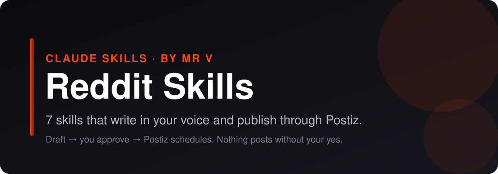

<p align="center">
  
</p>

# Reddit Skills for Claude Code, Claude.ai and Codex

<p align="center">
  
  
  
  
  
</p>

**Claude skills for Reddit.** 7 skills that plan, write, scrub and publish your Reddit content. They draft in your voice, strip the AI tells, and hand finished posts to [Postiz](https://postiz.com) for scheduling, only after you approve. No coding required.

> **On another platform too?** Matching bundles: [LinkedIn](https://github.com/mrvsubstack/linkedin-skills) · [X (Twitter)](https://github.com/mrvsubstack/x-skills) · [Instagram](https://github.com/mrvsubstack/instagram-skills) · [Threads](https://github.com/mrvsubstack/threads-skills) · [YouTube](https://github.com/mrvsubstack/youtube-skills) · [Facebook](https://github.com/mrvsubstack/facebook-skills) · [TikTok](https://github.com/mrvsubstack/tiktok-skills) · [Pinterest](https://github.com/mrvsubstack/pinterest-skills). Same voice rules, same approve-before-publish flow.

> **Want the full library?** These are a free sample of the Mr V Skills library: 240+ skills for writing, newsletters, offers, ads, SEO and research. [Get it on Substack →](https://promptwithjason.substack.com)

## Install

### Claude.ai (web) or Claude Desktop

1. Click **Customize** in the sidebar and open **Plugins**
2. **Add** → **Add marketplace** → **Add from a repository**
3. Paste `mrvsubstack/reddit-skills` and sync
4. Open **Discover**, find **reddit-skills**, click **+** to install
5. Start a new chat and ask for a Reddit post

> Plugins need a paid Claude plan with code execution turned on.

### Claude Code

```
/plugin marketplace add mrvsubstack/reddit-skills
/plugin install reddit-skills@reddit-skills
```

Or clone it and open the folder. The `.claude/skills/` folder points at every skill, so they load with no install:

```bash
git clone https://github.com/mrvsubstack/reddit-skills.git
cd reddit-skills
```

### Any agent (Codex, Cursor and others)

```bash
npx skills add mrvsubstack/reddit-skills
```

Or point your agent at `skills/*/SKILL.md`. Each one is plain markdown.

> **Found this useful? [Star the repo](https://github.com/mrvsubstack/reddit-skills).** It's how the next person finds it.

## What you can do

Ask in plain English. The right skill picks itself.

**Find the right subs:**
> "Find active subreddits where freelance designers hang out."

**Write a post:**
> "Write a value-first post for r/smallbusiness about my cash-flow fix."

**Check the rules:**
> "Check this draft against r/Entrepreneur's rules: [paste]"

**Mine the language:**
> "What are people in r/personalfinance struggling with this month?"

**Ship it:**
> "Post this to r/smallbusiness through Postiz tomorrow at 10am Eastern."

Every skill shows you a draft first. Nothing goes out until you say yes.

## The 7 skills

| Skill | What it does |
|---|---|
| **Reddit Post Writer** (`reddit-post-writer`) | Writes value-first Reddit posts in the style of a specific subreddit: reads the community's top posts and rules first, picks a post type that fits (detailed how-to, lessons learned, honest breakdown, question, resource share), writes a plain title and a body that gives the whole value in the post itself, and handles any mention of your product the way that community tolerates. |
| **Subreddit Finder** (`subreddit-finder`) | Finds the subreddits where your buyers actually talk, then sorts them by fit, activity and how open they are to someone like you: a shortlist of 5 to 15 subreddits, each with size and activity signals, the kind of posts that do well, self-promotion rules, entry requirements and a role for you (answer, post, listen only). |
| **Reddit Comment Drafter** (`reddit-comment-drafter`) | Drafts genuinely helpful Reddit comments that earn upvotes and profile clicks: picks threads worth answering, writes a comment that answers the exact question with specifics from your own experience, matches the subreddit's tone, and keeps any mention of your product inside the community's rules (usually none). Also handles replies on your own posts and tricky replies to critics. |
| **Reddit Rules Checker** (`reddit-rules-checker`) | Checks a Reddit post or comment draft against a specific subreddit's rules, sidebar, wiki, flair requirements and Reddit's own sitewide norms before you post. Returns a pass, a fix-list or a stop, with each rule quoted, the exact line in your draft that breaks it, and a corrected version. Flags self-promotion, links, title formats, banned topics, entry requirements and likely automod triggers. |
| **Reddit AMA Planner** (`reddit-ama-planner`) | Plans a Reddit AMA (Ask Me Anything) from first contact with moderators to the follow-up: picks the right subreddit, drafts the mod pitch, prepares proof of identity, writes the title and intro post, builds an answer bank for likely and hard questions, sets a schedule for the live session and promotion that stays within the rules. |
| **Reddit Audience Insights** (`reddit-audience-insights`) | Mines Reddit threads for what your audience actually says: their pains, desired outcomes, objections, failed solutions, the exact words they use and the questions they keep asking. Collects threads from chosen subreddits (by browsing or from what you paste), codes every relevant comment, counts how often each theme appears, and hands back a voice-of-customer report with real quotes, ready for copy, offers and content. |
| **Postiz Publisher** (`reddit-postiz-publisher`) | Checks a finished post against Reddit's rules, shows you an approval card, and schedules it through Postiz after you say yes. Saves a copy-ready file when Postiz isn't set up. |

Some skills suggest companion skills from the other platform bundles or from the [full Mr V library](https://promptwithjason.substack.com) (for example `voice-profile-bank` or `final-edit-modes`). They're optional. Without them, each skill still does its whole job.

## Publish with Postiz

By default the skills hand you a copy-ready post. Connect [Postiz](https://postiz.com) and Claude can schedule it for you.

**Why Postiz:** it's open source, you can self-host it for free, and one account covers Reddit plus 25+ other channels. The hosted plan works too.

**Setup (5 minutes):**

1. Create a Postiz account (or self-host it) and connect Reddit under **Add Channel**.
2. Copy your API key from **Settings** → **Public API**.
3. Save it as an environment variable, not in the chat:
   ```bash
   export POSTIZ_API_KEY="your-key"
   # self-hosted only:
   export POSTIZ_API_URL="https://your-domain/api/public/v1"
   ```
4. Restart Claude and ask: **"List my Postiz channels."**

Full guide: [`skills/reddit-postiz-publisher/references/postiz-setup.md`](skills/reddit-postiz-publisher/references/postiz-setup.md).

**How a post ships:**

1. A writer skill drafts the post.
2. You edit until you like it.
3. `reddit-postiz-publisher` checks it against Reddit's limits and shows an approval card: account, local time and UTC, media, exact text.
4. You say yes. It schedules through Postiz and gives you the post id.

No key? It saves the post to `post-ready-to-paste.txt` instead. Nothing breaks.

**Not published through Postiz:** Comments. The comment drafter hands you a copy-ready block; post it yourself.

## Voice rules every skill follows

1. A number or a statement in line 1. Never open on a question.
2. Odd precision beats round numbers: "$4,730" reads like a receipt, "$5k" like a guess.
3. One real detail per post. If you didn't give one, the skill asks. It never invents one.
4. No stock AI words (leverage, robust, elevate, navigate, foster, delve).
5. No reveal bridges ("Here's the thing", "Plot twist:") and no staccato stacks ("Simple. Fast. Done.").
6. Em dashes capped at about one per 100 words.

## Troubleshooting

| Problem | Fix |
|---|---|
| Skills don't activate | Start a new chat after installing. In Claude Desktop, check the plugin is listed under **Yours**, not only **Discover**. |
| "Postiz isn't connected" | `POSTIZ_API_KEY` isn't visible to Claude. Set it in your shell profile, open a new terminal, restart Claude. |
| 401 from Postiz | The key is wrong or was regenerated. Copy it again from Settings → Public API. |
| 429 from Postiz | You hit Postiz's hourly posting limit. Wait and try again. |
| Reddit channel not found | Connect it in the Postiz dashboard, or reconnect it if it shows as disabled. |
| Validation error on a post | A required platform setting is missing. The publisher reads the error and asks you for it. |

## Credits and license

Written from scratch by Mr.V.

MIT licensed. See [LICENSE](LICENSE). Not affiliated with Reddit or Postiz.

Made by **Mr.V** · [Substack](https://promptwithjason.substack.com)
